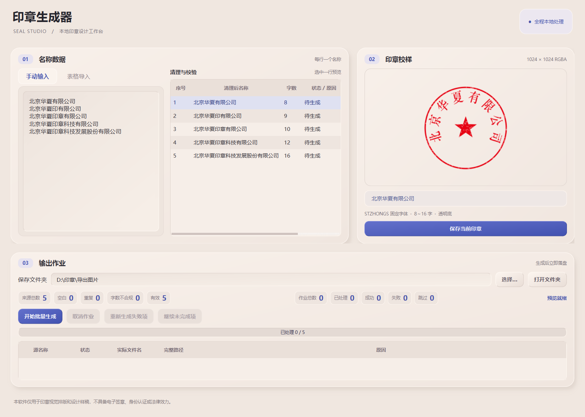

# 印章生成器

Windows 本地印章视觉排版工具。自有源代码以 **MIT** 许可证开源。

[下载 Windows 便携版](https://github.com/shangguanyiyu0011/seal-generator/releases/latest) · [下载与字体配置说明](docs/下载与字体配置.md) · [MIT 许可证](LICENSE)

> **下载前请读：本软件固定使用「华文中宋（STZhongsong）」字体，文件名 `STZHONGS.TTF`。GitHub 源码及公开 Windows 下载包均不附带字体，需要自行获取并确认使用授权。**
>
> Windows 便携版放入 `_internal/resources/fonts/STZHONGS.TTF`；源码版放入 `resources/fonts/STZHONGS.TTF`。未配置时会提示字体缺失，无法正常生成。请勿把其他字体改名替代。字体不适用本项目 MIT 许可证。



当前版本：**1.1.0（2026-10-26）**。奶油色新拟物界面；预览和文件读取在后台执行；支持工作表、表头选择，以及取消后继续和合并重试记录。

“印章生成器”是一款适用于 Windows 10/11 64 位系统的本地桌面工具。它支持手动输入或从 Excel、CSV 文件导入公司名称，预览数据并批量生成印章视觉排版样稿。

## 使用前提

- Windows 10 或 Windows 11 64 位系统。
- 从源码运行或自行打包时，需要 64 位 Python 3.12～3.14（推荐 Python 3.14）和 PowerShell。
- 项目固定使用华文中宋（STZhongsong）字体，开源包不附带该字体。请自行获取具有相应授权的 `STZHONGS.TTF`，并放入 `resources\fonts\STZHONGS.TTF`；详见下载与字体配置说明。
- 首次安装 Python 依赖需要连接软件包源；应用运行和印章处理过程不需要联网。

如果 Windows 中的 `python` 命令被 Microsoft Store 别名占用，可将下文命令开头的 `python` 替换为 `py -3.14`。一键构建脚本会依次尝试 `py -3.14`、`py -3.13`、`py -3.12`，再检查 PATH 中真实的 `python`/`python3`，并自动避开 WindowsApps Store 别名。脚本只接受 Python 3.12～3.14 的 64 位解释器；32 位或版本超出范围的解释器会被明确拒绝。

## 从源码运行

在项目根目录打开 PowerShell，使用同一个 Python 解释器依次执行：

```powershell
python -m pip install -r requirements-dev.txt
python -m pip install -e .
python -m seal_generator.app
```

第二条命令把采用 `src` 目录结构的本项目安装为可编辑包，因此第三条命令可从项目根目录稳定启动。使用 Python Launcher 时，对应命令为：

```powershell
py -3.14 -m pip install -r requirements-dev.txt
py -3.14 -m pip install -e .
py -3.14 -m seal_generator.app
```

如需单独复现构建脚本使用的两项启动检查，可在已安装项目依赖后运行：

```powershell
python -m seal_generator.app --smoke-test
python -m seal_generator.app --gui-smoke-test
```

第一项检查自行配置的固定字体和核心渲染，第二项以离屏模式构造完整图形界面并立即关闭，不进入交互事件循环。

## 使用方法

### 手动输入

1. 在“手动输入”区域每行填写一个公司名称。
2. 软件会清理首尾空白、统计有效项，并跳过重复项和字数不合规项。
3. 选择一条有效名称即可查看预览。

### 从表格导入

1. 选择 `.xlsx`、`.xlsm`、`.xls` 或 `.csv` 文件。
2. Excel 文件可以选择工作表。默认**保留首行作为数据**；表格有表头时勾选“首行是表头”，表头不会参与生成。
3. 检查数据预览，并在下拉框中选择公司名称所在列。预览最多显示前 100 行，校验与批量处理会使用全部行。
4. 确认记录状态后选择本地保存文件夹，再开始批量生成。

文件读取期间可以继续操作窗口，批量生成会等到读取结束后启用。快速切换预览时只处理最新待选项；之前完成的预览会缓存，避免重复渲染。点击“保存当前印章”时若预览尚在生成，会在该名称的预览完成后保存；切换名称或关闭窗口会撤销这次待保存操作。

清理后的印章名称必须为 **8～16 个排版字符**。少于 8 个或超过 16 个字符的名称不能生成，批量处理中会被跳过。

## 固定排版规则

- 8～16 个字分别使用参考图对应的九套固定比例。字号、字宽、弧度、圆框和五角星均由对应字数的版式确定，用户不能修改。
- 字距使用经过比对调整的固定参数；纯中文名称使用等角度的字符中心间隔，8 字首尾中心跨度为 214°，16 字为 254°。中英混排继续按实际字宽适配，并检查笔画碰撞与圆框边界。
- 常用中文文字的可见高度保持接近一致，不会随着字数增加而持续缩小；字数较多时只按固定比例横向压缩字形，字体仍固定为 `STZHONGS.TTF`。
- 名称含特殊宽字符时，软件会在 132～140 的固定字号范围内进行安全排版检查。如果在该范围内仍会发生文字重叠、触碰圆框等问题，则明确提示无法生成，不会输出比例失真的印章。
- 在小窗口或 Windows 高显示缩放下，主工作区可以纵向滚动，清理校验表的表头和数据行不会被裁掉，所有操作区域均可滚动到达。

## 字体与输出规则

- 所有文字只能使用固定字体 `STZHONGS.TTF`，软件不会回退到系统字体。
- 固定字体缺失、损坏、无法加载，或名称含有该字体不支持的字符时，对应预览和生成会停止并显示中文原因。
- 每张图片固定为 1024×1024 的 RGBA PNG，背景完全透明；透明区不会绘制白色背景、白边或白色磨损颗粒。
- 保存时不会覆盖已有文件。同名文件已存在时，会依次使用 `_2`、`_3` 等后缀。
- 点击“取消”后，当前正在处理的一张完成后停止领取后续任务；已经保存的图片会保留，未处理项显示为已取消。
- “重新生成失败项”只重试上次执行中的失败记录，不会重复生成已经成功或被规则跳过的记录。
- “继续未完成项”在当前会话中继续被取消、尚未生成的记录；成功项不会重复保存。失败重试与继续处理都会合并回整批作业记录，保留已有成功路径和总数。更换输入来源会清空上一批作业统计。

## 构建 Windows 文件夹便携版

在项目根目录执行：

```powershell
powershell -ExecutionPolicy Bypass -File .\build.ps1
```

脚本会按上述顺序选择可用的 64 位 Python 3.12～3.14，安装 `requirements-dev.txt` 中的依赖，运行完整测试，执行 PyInstaller onedir 构建，并依次运行两项打包验证：`--smoke-test` 验证冻结资源路径、内置字体和核心渲染，`--gui-smoke-test` 使用离屏模式创建应用与主窗口、处理界面事件后正常关闭。任一检查返回非零退出码都会中止构建。找不到符合版本与位数要求的解释器时，脚本会停止并显示中文检查范围，不会静默使用错误的 Python。

打包配置会在构建进程内限定 DLL 查找范围，避免从 PATH 中的 PDF、图片工具链误收集不兼容的 ICU 或 Windows 运行库；不会修改系统或用户保存的环境变量。

构建成功后的主程序位于：

```text
dist\印章生成器\印章生成器.exe
```

构建脚本实际运行的打包程序检查可手动复现为：

```powershell
.\dist\印章生成器\印章生成器.exe --smoke-test
.\dist\印章生成器\印章生成器.exe --gui-smoke-test
```

这是文件夹便携版。分发或迁移时必须把 `dist\印章生成器` 文件夹及其内部内容**完整复制**到目标电脑，不能只复制 `印章生成器.exe`。目标电脑不需要安装 Python；双击该文件夹中的 `印章生成器.exe` 即可运行。项目中的参考图片不会进入分发目录。

## 隐私与法律声明

名称、导入表格和生成图片均只在本机处理。应用不会上传数据，不包含账号、遥测或联网更新功能。

**本软件仅用于印章视觉排版和设计样稿，不具备电子签章、身份认证或法律效力。**

## 测试说明

完整测试需要先自行配置上述字体：

```powershell
python -m pytest -q
```

不配置字体时可验证文件读取、批量调度、文件保存、字符校验和打包配置：

```powershell
python -m pytest tests/test_importers.py tests/test_batch.py tests/test_storage.py tests/test_validation.py tests/test_packaging.py -k "not bundled_font"
```

这只是测试子集，不代表渲染和完整 GUI 已在缺少字体的环境中通过。

## 许可证

自有源代码使用 [MIT](LICENSE) 许可证。第三方依赖遵循各自许可，详见 [第三方说明](THIRD_PARTY_NOTICES.md)。华文中宋字体未包含在开源仓库和公开下载包中，不在 MIT 授权范围内。自行打包后对外分发前，须单独确认字体及第三方依赖的再分发条件。
